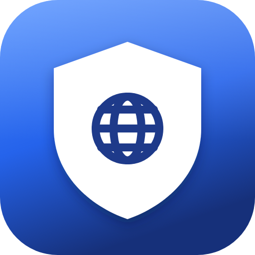

# Keenetic Policy

Переключает политику доступа Keenetic для этого Mac прямо из строки меню.
Без веб-интерфейса роутера: клик по иконке — и трафик идёт напрямую или через
VPN, как выбрано.

Switch the Keenetic access policy of this Mac from the menu bar. No router web
interface: one click and the traffic goes direct or through the VPN, whichever
you picked.

Website: <https://indapublic.github.io/keenetic-policy/>

## Установка

```sh
brew tap indapublic/keenetic-policy https://github.com/indapublic/keenetic-policy
brew trust --formula indapublic/keenetic-policy/keenetic-policy
brew install indapublic/keenetic-policy/keenetic-policy
brew services start keenetic-policy
```

Затем один раз настройте:

```sh
keenetic-policy --setup
```

Скрипт спросит адрес роутера, логин, пароль и MAC этого компьютера, проверит
связь и покажет список политик. Пароль уходит в связку ключей macOS, в файлах
его нет.

Из клона репозитория то же самое делает `make install` (или `make
install-local`, если не хочется ставить через Homebrew).

## Install

```sh
brew tap indapublic/keenetic-policy https://github.com/indapublic/keenetic-policy
brew trust --formula indapublic/keenetic-policy/keenetic-policy
brew install indapublic/keenetic-policy/keenetic-policy
brew services start keenetic-policy
keenetic-policy --setup
```

Or download [KeeneticPolicy.dmg](https://github.com/indapublic/keenetic-policy/releases/latest/download/KeeneticPolicy.dmg),
drag the app to Applications and open it once: from then on it starts at every
login.

## Команды

| Команда | Что делает |
| --- | --- |
| `make install` | Ставит из Homebrew-тапа и запускает сервис |
| `make install-local` | Копирует в `~/Applications` и добавляет в объекты входа |
| `make update` | Обновляет до последнего релиза |
| `make uninstall` | Останавливает сервис и удаляет |
| `make start`, `stop`, `restart` | Управление сервисом |
| `make status` | Состояние сервиса и память |
| `make logs` | Смотреть лог |
| `make` | Собрать `KeeneticPolicy.app` |
| `make test` | Тесты на заглушке роутера |
| `make lint` | Проверка Swift и shellcheck |
| `make release VERSION=x.y.z` | Собрать, подписать, нотаризовать и опубликовать релиз |
| `make icon` | Перерисовать иконку из SVG (нужен Google Chrome) |

## Commands

The same list in English: `make help` prints it from a clone.

| Command | What it does |
| --- | --- |
| `make install` | Install from the Homebrew tap and start the service |
| `make install-local` | Copy to `~/Applications` and add to Login Items |
| `make update` | Upgrade to the latest release |
| `make uninstall` | Stop the service and uninstall |
| `make start`, `stop`, `restart` | Control the service |
| `make status` | Service state and memory footprint |
| `make logs` | Follow the log |
| `make` | Build `KeeneticPolicy.app` |
| `make test` | Run the tests against a mock router |
| `make lint` | Type-check the sources and run shellcheck |
| `make release VERSION=x.y.z` | Build, sign, notarize and publish a release |
| `make icon` | Render the icon PNGs from the SVGs (needs Google Chrome) |

## Терминал

```sh
keenetic-policy --list         # политики, ● — текущая
keenetic-policy --current      # имя текущей политики (пусто — по умолчанию)
keenetic-policy --set Policy0  # переключить
keenetic-policy --set default  # вернуть политику по умолчанию
keenetic-policy --check        # настройки и связь
keenetic-policy --setup        # перенастроить
```

## Terminal

```sh
keenetic-policy --list         # policies, ● marks the current one
keenetic-policy --current      # current policy name (empty for the default)
keenetic-policy --set Policy0  # switch
keenetic-policy --set default  # back to the default policy
keenetic-policy --check        # settings and connection
keenetic-policy --setup        # reconfigure
```

## Языки

Интерфейс и вывод в терминале есть на русском и английском. Язык берётся из
системных настроек; для приложения его можно задать отдельно в
System Settings > General > Language & Region > Applications. Или жёстко, в
`~/.config/keenetic-policy/config.json`:

```json
{ "language": "ru" }
```

## Languages

The interface and the CLI output come in English and Russian. The language
follows the system settings; per app it can be set in System Settings >
General > Language & Region > Applications. To pin it, add to
`~/.config/keenetic-policy/config.json`:

```json
{ "language": "en" }
```

## Как это работает

1. `GET /auth` — роутер отдаёт `X-NDM-Realm` и `X-NDM-Challenge`.
2. `POST /auth` с `sha256(challenge + md5(login:realm:password))` — cookie сессии.
3. `GET /rci/show/ip/policy` — список политик, `GET /rci/show/ip/hotspot` —
   политика этого Mac.
4. `POST /rci/ip/hotspot/host/policy` с `{"mac": ..., "policy": "Policy0"}` —
   переключение. «Политика по умолчанию» — это не объект на роутере, а
   отсутствие политики у клиента, поэтому она снимается через `{"no": true}`.

Всё по локальной сети, наружу ничего не уходит.

## How it works

The router's RCI API is the same one its web interface uses. The app logs in
with the challenge-response scheme above, reads `show/ip/policy` and the
client's `policy` field, and posts the new policy to
`/rci/ip/hotspot/host/policy`. The default policy is the absence of the
attribute, so it is removed with `{"no": true}`.

Everything stays on the local network.

## Нюансы

- Политика привязана к MAC. У Wi-Fi и Ethernet они разные: если переключитесь
  с Wi-Fi на кабель, запустите `--setup` заново (или поправьте `mac` в конфиге).
- Уже открытые соединения могут какое-то время идти по старому маршруту,
  новые пойдут по новой политике сразу.
- Если Mac не в домашней сети, приложение покажет ошибку связи.
- «Без доступа в интернет» в веб-интерфейсе — это не политика, а флаг `deny`
  у клиента; в меню его нет.

## Logs

`~/Library/Logs/KeeneticPolicy.log`: запуск с версией и версией macOS,
переключения политик и ошибки. Ничего больше. После 512 КБ файл уезжает в
`KeeneticPolicy.old.log`.

```sh
open -R ~/Library/Logs/KeeneticPolicy.log
```

## Удаление

```sh
brew services stop keenetic-policy
brew uninstall keenetic-policy
security delete-generic-password -s keenetic-policy -a admin
rm -rf ~/.config/keenetic-policy
```

Если ставили без Homebrew: `KeeneticPolicy --unregister`, затем удалите
`~/Applications/KeeneticPolicy.app`.

## License

MIT
